# GAMES101-HW
Records of homework from GAMES101

= Homework 0 =  

26/9/29 - complete homework0

= Homework 1 =

26/9/30 - accomplish Model Matrix Part (rotate around z-axis)

26/10/01 - complete homework1 (projection matrix + rotate around more axis)

= Homework 2 =

26/10/2 - accomplish rasterize_Triangle function without check

26/10/3 - fixed some bugs

26/10/6 - complete homework2
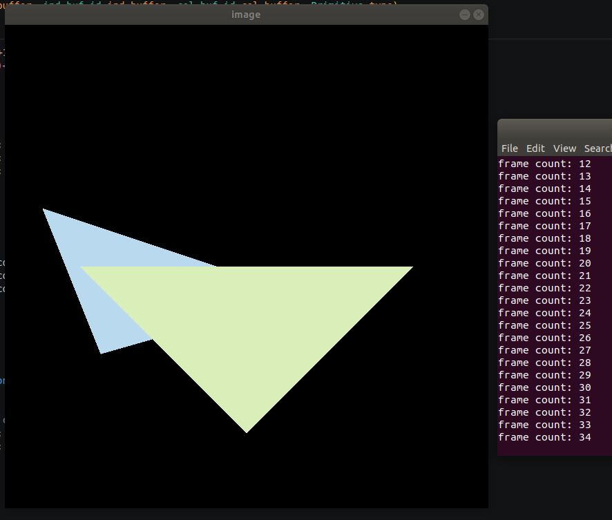

= Homework 3 =

26/10/9 - accomplish interpolation part; fixed a few bugs  
(interpolated normal output)
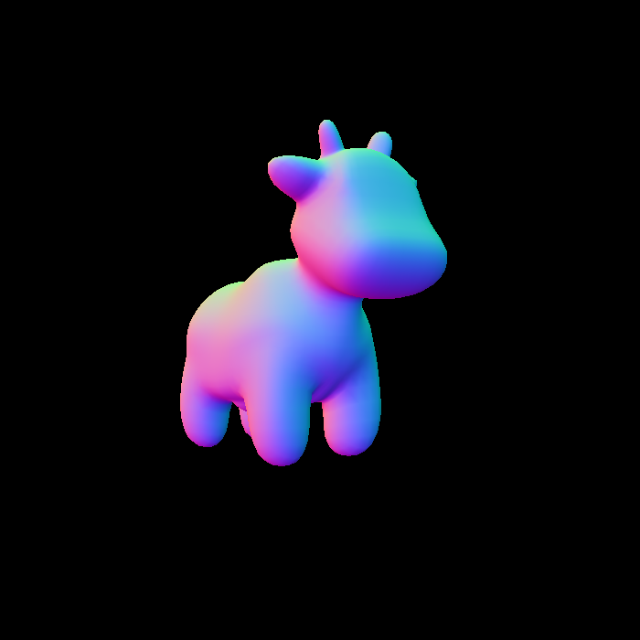

26/10/11 - accomplish Phong part，未验证

26/10/12   
调试并修复phong shader  
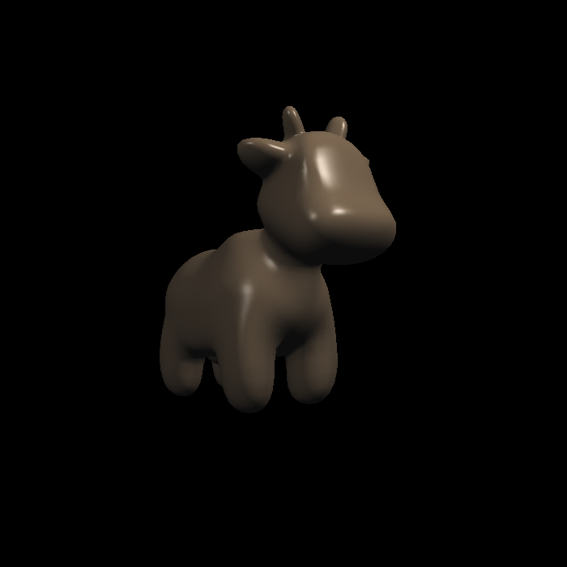

实现、调试、修复texture Shader  
  
normal插值后未重新归一化的结果：  
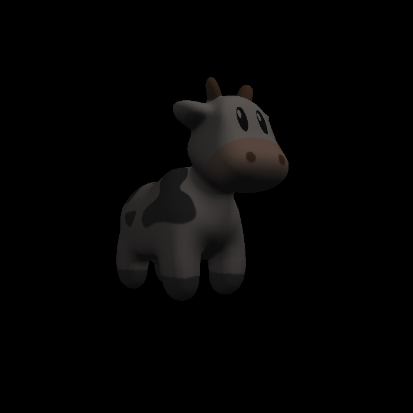

实现、调试、修复bump shader  
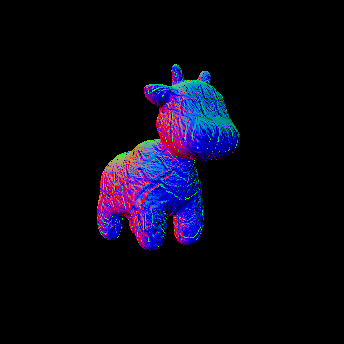

实现、调试、修复displacement shader
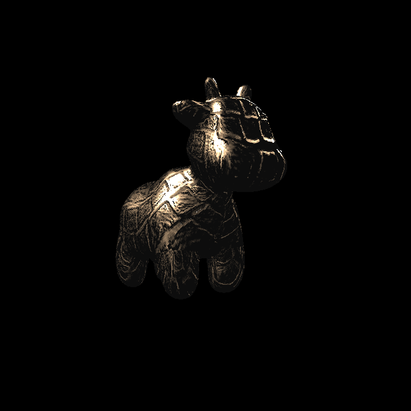  
未移动position效果：  
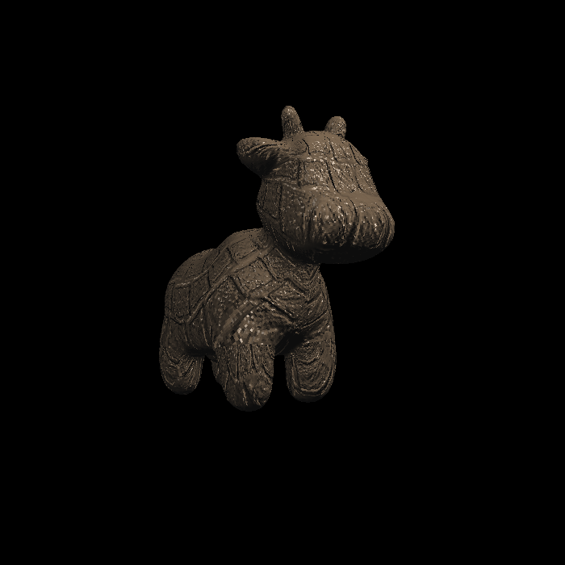

Homework 3 completed

= Homework 4 =

26/10/13  
实现、调试、修复homework4  
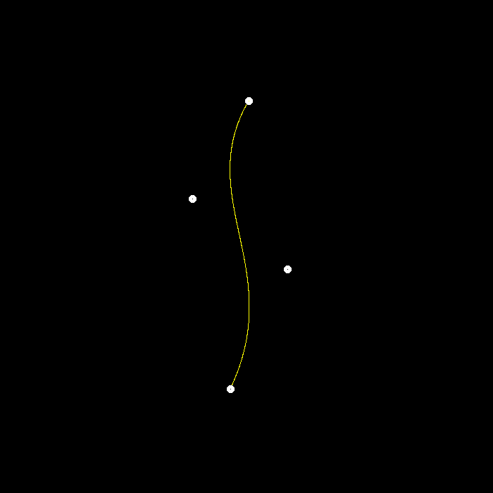

MSAA：创建antialiasMSAA，传入曲线点集，创建包围盒，进行MSAA反走样  
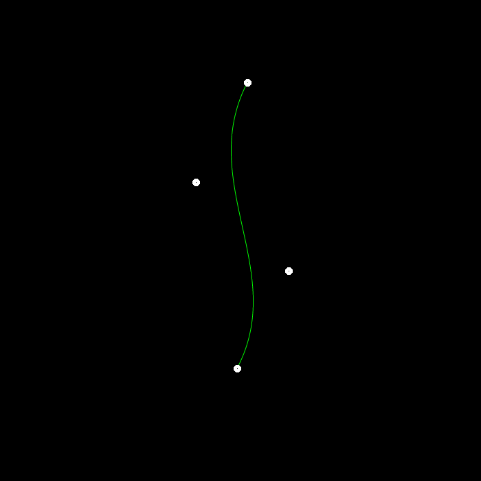  
反走样优化：取消包围盒，改为标记 曲线点集 中每个点附近3*3的格子，只对标记的格子进行MSAA反走样  
对于斜线的渲染速度，从原先10s左右提升到1秒内  

Homework 4 completed

= Homework 5 =

26/10/14  
HW5:实现Render的发射坐标计算，未调试

26/10/15  
HW5：实现Triangle的射线求交  
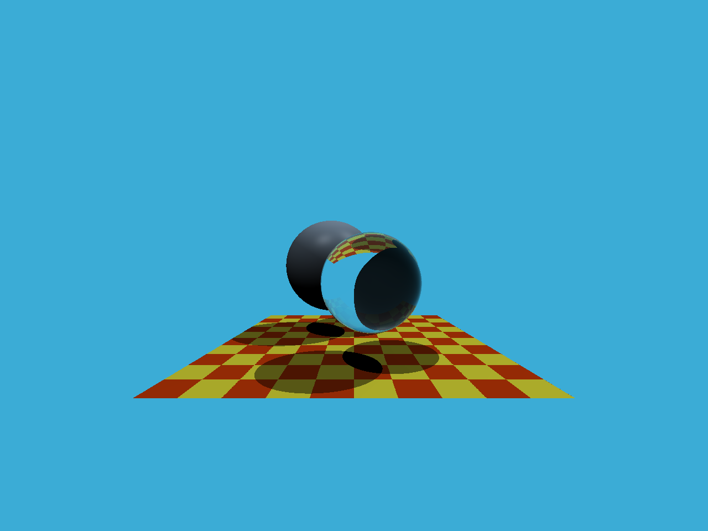

Homework 5 completed

= Homework 6 =

26/10/16  
HW6：实现Renderer射线发射，未验证

26/10/17  
HW6：  
实现三角形求交intersection设置，未验证    
实现intersect包围盒射线碰撞判断，未验证  
实现BVH getIntersection  
完成调试、修复bug  
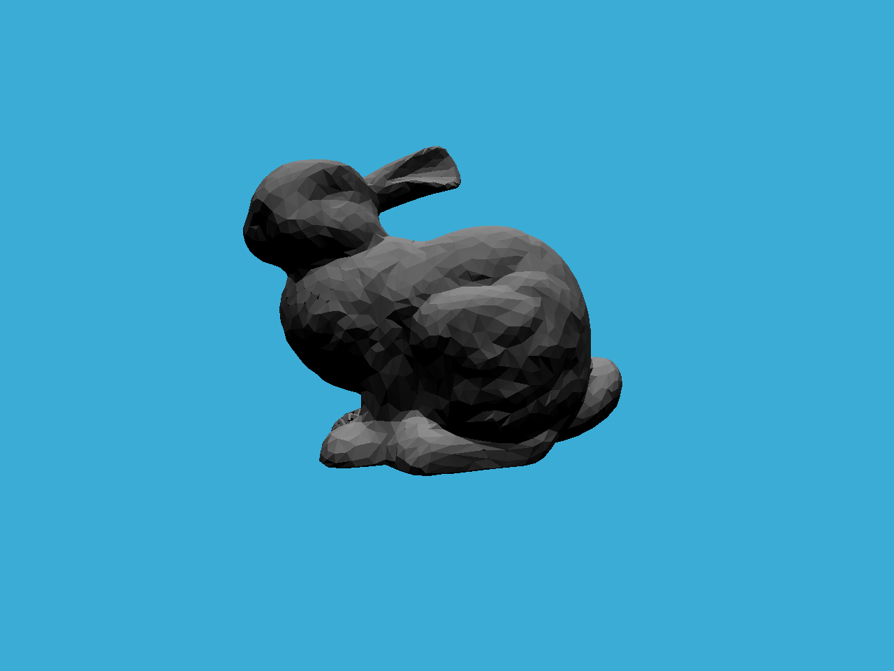
修复三角形intersection.coords计算错误  
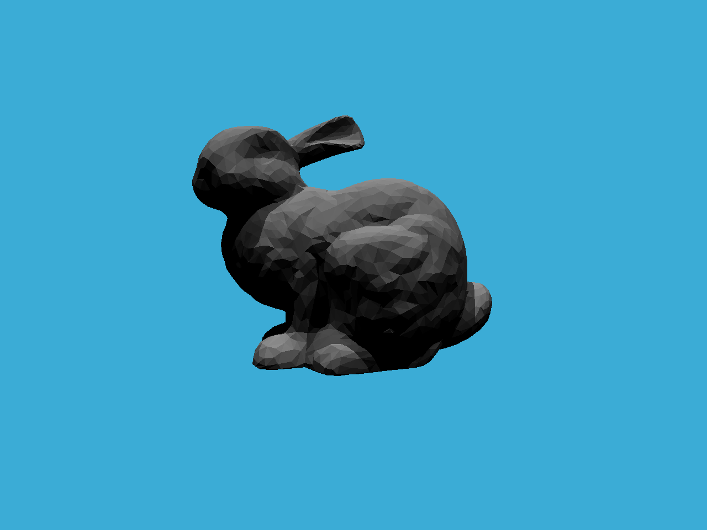

Homework 6 completed

= Homework 7 =

26/10/18  
HW7：从HW6迁移已有部分代码  
HW7：Review HW6 Scene.castRay

26/10/20  
HW7：编写直接光部分，存在阴影遮挡判断问题？，右侧小方块全黑  
.png)

26/10/21
HW7：添加间接光，存在bug  
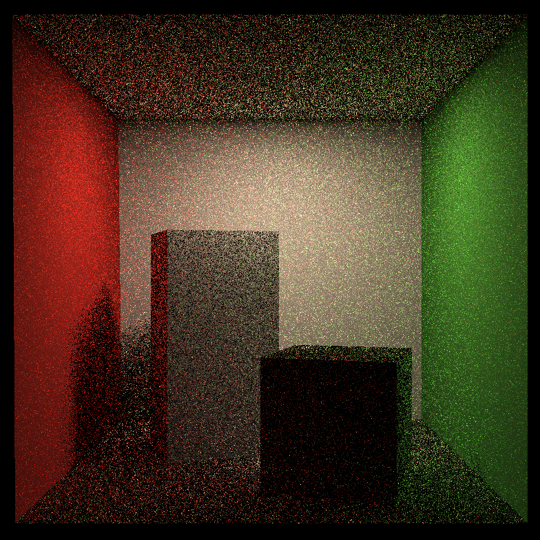